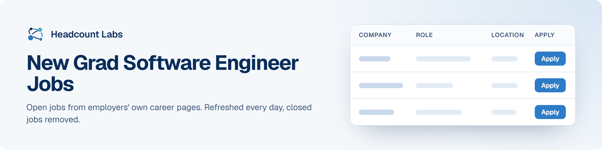

# New Grad Software Engineer Jobs

Entry-level and new graduate software engineering jobs at US employers.

**144 open jobs** · 32 new since the last update · 13 removed because they closed or left the employer's board · updated October 20, 2026 at 5:37 AM EDT

This list is built and refreshed every day by [Headcount Labs](https://headcountlabs.com/?utm_source=github&utm_medium=job-list&utm_campaign=new-grad-software-engineer-jobs), which reads jobs straight from employers' own career pages and job boards. Every job here was still listed on its source board when we last read that board, within the past 3 days, and was posted in the past 30 days. Copies of the same job are merged into one row, and jobs that close are removed at the next update.

Want this data in your own app or agent? Use the [Headcount Labs jobs API](https://headcountlabs.com/docs/?utm_source=github&utm_medium=job-list&utm_campaign=new-grad-software-engineer-jobs) (free tier), the [MCP server](https://headcountlabs.com/mcp/?utm_source=github&utm_medium=job-list&utm_campaign=new-grad-software-engineer-jobs) for Claude, ChatGPT and other AI assistants, or the [open dataset](https://huggingface.co/datasets/HeadcountLabs/job-postings) on Hugging Face ([example queries](https://github.com/HeadcountLabs/job-postings)).

**Full dataset.** A bigger, one-off snapshot dated 2026-10-19 (all matching jobs, not only the open jobs below) is on Hugging Face: [Tech and software jobs](https://huggingface.co/datasets/HeadcountLabs/tech-jobs). It loads with `datasets.load_dataset` and is licensed CC BY 4.0.

**Jump to:** [Posted in the last 7 days (48)](#posted-in-the-last-7-days) · [Posted 8 to 30 days ago (96)](#posted-8-to-30-days-ago)

**Columns.** *Apply* opens the original posting on the employer's site. *Details* opens the job on Headcount Labs, with every posting we found for it. *Remote* shows what the employer states; a dash means the posting doesn't say. *Pay* is the range the employer published.

## Posted in the last 7 days

| Company | Role | Location | Remote | Pay | Posted | Apply | Details |
| --- | --- | --- | --- | --- | --- | :---: | :---: |
| **Jobgether** | Software Engineer 1 - Cloud Infrastructure | United States | Remote | $122k–$176k/yr | Oct 19 |  | <a href="https://headcountlabs.com/catalog/jobs/ed53eb8f-e04e-42ee-8c71-00f38b38855e?utm_source=github&utm_medium=job-list&utm_campaign=new-grad-software-engineer-jobs">via Headcount Labs</a> |
| **JMARK Business Solutions, Inc.** | Cloud Systems Administrator and Developer I | Springfield, MO | On-site | — | Oct 19 |  | <a href="https://headcountlabs.com/catalog/jobs/c337fe3e-2cbd-4b25-8bbc-45e99bb3c12e?utm_source=github&utm_medium=job-list&utm_campaign=new-grad-software-engineer-jobs">via Headcount Labs</a> |
| **Accenture Federal Services** | Junior Software Developer | St. Louis, MO | — | $66k–$126k/yr | Oct 19 |  | <a href="https://headcountlabs.com/catalog/jobs/5601ec9f-264d-4f21-a415-9ceb9e3cbc65?utm_source=github&utm_medium=job-list&utm_campaign=new-grad-software-engineer-jobs">via Headcount Labs</a> |
| **VTG** | Junior Software Engineer | Hanover, MD | — | $120k–$150k/yr | Oct 18 |  | <a href="https://headcountlabs.com/catalog/jobs/99e5c7ed-e7fb-4f2f-8869-68ce1d033bd0?utm_source=github&utm_medium=job-list&utm_campaign=new-grad-software-engineer-jobs">via Headcount Labs</a> |
| **VTG** | Junior RF Software Engineer | Hanover, MD | — | $120k–$150k/yr | Oct 18 |  | <a href="https://headcountlabs.com/catalog/jobs/3d1213a1-719b-4b96-975b-f75a080c6609?utm_source=github&utm_medium=job-list&utm_campaign=new-grad-software-engineer-jobs">via Headcount Labs</a> |
| **Laansu** | Junior Software Developer | Sterling, VA | Hybrid | $80k–$90k/yr | Oct 17 |  | <a href="https://headcountlabs.com/catalog/jobs/dce1f48a-f587-4a9e-bdd8-cf876d5d21a3?utm_source=github&utm_medium=job-list&utm_campaign=new-grad-software-engineer-jobs">via Headcount Labs</a> |
| **Ace IT Careers** | Associate Software Test Analyst | 

6 locations
Detroit, MI Kansas City, MO Nashville, TN Newark, NJ Richmond, VA United States
 | Remote | — | Oct 17 |  | <a href="https://headcountlabs.com/catalog/jobs/0376756f-9503-4546-bacb-632646ea1ff6?utm_source=github&utm_medium=job-list&utm_campaign=new-grad-software-engineer-jobs">via Headcount Labs</a> |
| **Sierra Nevada Corporation** | Software Engineer I | 

3 locations
Lone Tree, CO Dayton, OH Plano, TX
 | On-site | $82k–$113k/yr | Oct 16 |  | <a href="https://headcountlabs.com/catalog/jobs/59294028-63f8-4e45-870b-98f17328c55a?utm_source=github&utm_medium=job-list&utm_campaign=new-grad-software-engineer-jobs">via Headcount Labs</a> |
| **Echo Global Logistics, Inc** | Associate Software Support Engineer | Reno, NV | Hybrid | — | Oct 16 |  | <a href="https://headcountlabs.com/catalog/jobs/cd3eb1ff-2349-4522-9ac2-60ffdf3fed14?utm_source=github&utm_medium=job-list&utm_campaign=new-grad-software-engineer-jobs">via Headcount Labs</a> |
| **CoStar Realty Information, Inc.** | Software Engineer I- CoStar Suite- Arlington, VA | Arlington, VA | — | $103k–$154k/yr | Oct 16 |  | <a href="https://headcountlabs.com/catalog/jobs/ab95c136-c619-4564-b34d-faef6d427505?utm_source=github&utm_medium=job-list&utm_campaign=new-grad-software-engineer-jobs">via Headcount Labs</a> |
| **Barrios Technology** | Space Operations Computing - Software Engineer (New Grad) | Houston, TX | — | — | Oct 16 |  | <a href="https://headcountlabs.com/catalog/jobs/6abf11a6-244d-4e30-8652-00a700bb5d3c?utm_source=github&utm_medium=job-list&utm_campaign=new-grad-software-engineer-jobs">via Headcount Labs</a> |
| **Axon** | Software Engineer I | Seattle, WA | — | $106k–$170k/yr | Oct 16 |  | <a href="https://headcountlabs.com/catalog/jobs/f17d2638-5944-459f-b93c-4a31dcbe4fac?utm_source=github&utm_medium=job-list&utm_campaign=new-grad-software-engineer-jobs">via Headcount Labs</a> |
| **ASRC Federal Holding Company** | Associate Software Engineer | Moorestown, NJ | — | — | Oct 16 |  | <a href="https://headcountlabs.com/catalog/jobs/5766746c-3058-4d29-bbfc-1a3d7c0a935b?utm_source=github&utm_medium=job-list&utm_campaign=new-grad-software-engineer-jobs">via Headcount Labs</a> |
| **Tyler Technologies** | Associate Software Support Specialist | 

5 locations
United States Yarmouth, ME Falmouth, ME Orono, ME Renton, WA
 | — | $50k–$58k/yr | Oct 15 |  | <a href="https://headcountlabs.com/catalog/jobs/d6676e8d-dede-4e13-a07b-03336539ed2f?utm_source=github&utm_medium=job-list&utm_campaign=new-grad-software-engineer-jobs">via Headcount Labs</a> |
| **Schwab** | Associate Software Engineer | Austin, TX | — | $44.23–$45.19/hr | Oct 15 |  | <a href="https://headcountlabs.com/catalog/jobs/7ff5ad86-9726-4c26-bf35-9d01ea141ba9?utm_source=github&utm_medium=job-list&utm_campaign=new-grad-software-engineer-jobs">via Headcount Labs</a> |
| **SageCor Solutions** | Software Engineer 1 (FST - 145) | Hanover, MD | — | — | Oct 15 |  | <a href="https://headcountlabs.com/catalog/jobs/57d063d1-1f8c-4af1-bf47-24bfad31b0ab?utm_source=github&utm_medium=job-list&utm_campaign=new-grad-software-engineer-jobs">via Headcount Labs</a> |
| **North Atlantic Industries, Inc** | Test Engineer I - Software | Bohemia, NY | — | $65k–$80k/yr | Oct 15 |  | <a href="https://headcountlabs.com/catalog/jobs/5e53c41f-d1c3-4e29-9d74-aec4a15be500?utm_source=github&utm_medium=job-list&utm_campaign=new-grad-software-engineer-jobs">via Headcount Labs</a> |
| **MartinFed** | Junior Software Engineer (TS Clearance) | Starkville, MS | — | — | Oct 15 |  | <a href="https://headcountlabs.com/catalog/jobs/4ee0925e-0f0d-41a4-8d22-fc0135245568?utm_source=github&utm_medium=job-list&utm_campaign=new-grad-software-engineer-jobs">via Headcount Labs</a> |
| **Intuit** | Software Engineer 1 | 

5 locations
Mountain View, CA San Diego, CA New York, NY Charlotte, NC Atlanta, GA
 | — | $55.50–$75/hr | Oct 15 |  | <a href="https://headcountlabs.com/catalog/jobs/a9aa2cb3-bc80-4950-b013-8b772e87dd69?utm_source=github&utm_medium=job-list&utm_campaign=new-grad-software-engineer-jobs">via Headcount Labs</a> |
| **Intercontinental Exchange Holdings, Inc.** | Software Engineer I | 

3 locations
Jacksonville, FL Provo, UT Atlanta, GA
 | — | — | Oct 15 |  | <a href="https://headcountlabs.com/catalog/jobs/2d4c24ed-407e-47f4-9aee-eceddbd5d0ab?utm_source=github&utm_medium=job-list&utm_campaign=new-grad-software-engineer-jobs">via Headcount Labs</a> |
| **Honeycomb.io** | Software Engineer I - LLM Observability | United States | Remote | — | Oct 15 |  | <a href="https://headcountlabs.com/catalog/jobs/d98450b8-6ad2-4464-92fb-e39f57d826b8?utm_source=github&utm_medium=job-list&utm_campaign=new-grad-software-engineer-jobs">via Headcount Labs</a> |
| **Hartz Mountain Corp** | JUNIOR FULL STACK DEVELOPER | Secaucus, NJ | — | $84k–$105k/yr | Oct 15 |  | <a href="https://headcountlabs.com/catalog/jobs/2ce759af-ba3f-4635-aa36-27855b22f164?utm_source=github&utm_medium=job-list&utm_campaign=new-grad-software-engineer-jobs">via Headcount Labs</a> |
| **FREEDOM SOLUTIONS GR** | Associate Software Engineer | Denver, CO | Hybrid | $105k–$125k/yr | Oct 15 |  | <a href="https://headcountlabs.com/catalog/jobs/91c385b7-cba7-4a55-ac21-3591b8f7019c?utm_source=github&utm_medium=job-list&utm_campaign=new-grad-software-engineer-jobs">via Headcount Labs</a> |
| **Flexi Software** | Junior Full-Stack Software Engineer | Atlanta, GA | Hybrid | — | Oct 15 |  | <a href="https://headcountlabs.com/catalog/jobs/fa4205e0-de1c-4198-9f2b-7278da181024?utm_source=github&utm_medium=job-list&utm_campaign=new-grad-software-engineer-jobs">via Headcount Labs</a> |
| **Flexi** | Junior Full-Stack Software Engineer | Atlanta, GA | Hybrid | — | Oct 15 |  | <a href="https://headcountlabs.com/catalog/jobs/9d47ad83-0626-41b6-a2a6-a90c3b7f93dc?utm_source=github&utm_medium=job-list&utm_campaign=new-grad-software-engineer-jobs">via Headcount Labs</a> |
| **CoStar Realty Information, Inc.** | Software Engineer I - BizBuySell - San Francisco, CA | San Francisco, CA | — | $125k–$172k/yr | Oct 15 |  | <a href="https://headcountlabs.com/catalog/jobs/cbdca5d9-5373-4874-94d0-29f68139faa1?utm_source=github&utm_medium=job-list&utm_campaign=new-grad-software-engineer-jobs">via Headcount Labs</a> |
| **Corelation Inc** | Core Developer I (Card Squad) | San Diego, CA | Remote | $77k–$92k/yr | Oct 15 |  | <a href="https://headcountlabs.com/catalog/jobs/da1ba379-6a8d-4957-b8a5-9628d1787f49?utm_source=github&utm_medium=job-list&utm_campaign=new-grad-software-engineer-jobs">via Headcount Labs</a> |
| **Comcast** | Junior Software Engineer- 4 Days Onsite- Englewood, CO- FreeWheel | 

2 locations
Englewood, CO Reston, VA
 | On-site | $97k–$146k/yr | Oct 15 |  | <a href="https://headcountlabs.com/catalog/jobs/326cb4d4-0a6b-40f2-b2b7-fda5ae9e3bb8?utm_source=github&utm_medium=job-list&utm_campaign=new-grad-software-engineer-jobs">via Headcount Labs</a> |
| **ASRC Federal** | Associate Software Engineer | Moorestown, NJ | On-site | — | Oct 15 |  | <a href="https://headcountlabs.com/catalog/jobs/cc651d91-f950-4157-a620-5c2148568092?utm_source=github&utm_medium=job-list&utm_campaign=new-grad-software-engineer-jobs">via Headcount Labs</a> |
| **Ascend Analytics** | Junior Software Engineer | Boulder, CO | Hybrid | $78k–$91k/yr | Oct 15 |  | <a href="https://headcountlabs.com/catalog/jobs/39362452-6061-4ceb-9475-94afc1dfe635?utm_source=github&utm_medium=job-list&utm_campaign=new-grad-software-engineer-jobs">via Headcount Labs</a> |
| **Affirm** | Software Engineer I, Fullstack (Search) | United States | Remote | — | Oct 15 |  | <a href="https://headcountlabs.com/catalog/jobs/0a4c3a44-1f1f-492b-a4b6-6f01a7f98ad9?utm_source=github&utm_medium=job-list&utm_campaign=new-grad-software-engineer-jobs">via Headcount Labs</a> |
| **AAON, Inc.** | D365 Developer I | Tulsa, OK | — | — | Oct 15 |  | <a href="https://headcountlabs.com/catalog/jobs/105ff4a9-0cad-41d5-a9da-6fff3aff544a?utm_source=github&utm_medium=job-list&utm_campaign=new-grad-software-engineer-jobs">via Headcount Labs</a> |
| **VTG** | Associate Software Engineer | Manassas, VA | — | $75k–$90k/yr | Oct 14 |  | <a href="https://headcountlabs.com/catalog/jobs/1dc46e85-bbd5-4f71-800a-b3276b39e75a?utm_source=github&utm_medium=job-list&utm_campaign=new-grad-software-engineer-jobs">via Headcount Labs</a> |
| **MED Medtronic Inc** | Software Quality Engineer I (Reliability/Compliance) | 

2 locations
Mounds View, MN Newton, MA
 | On-site | $65k–$97k/yr | Oct 14 |  | <a href="https://headcountlabs.com/catalog/jobs/83aab029-078a-49df-b734-d96cdc666cdc?utm_source=github&utm_medium=job-list&utm_campaign=new-grad-software-engineer-jobs">via Headcount Labs</a> |
| **Flourish and Thrive Labs** | Junior Salesforce Developer &#124; Public Health | United States | Remote | — | Oct 14 |  | <a href="https://headcountlabs.com/catalog/jobs/5066d92b-2c44-4f02-9c53-88c8c922a476?utm_source=github&utm_medium=job-list&utm_campaign=new-grad-software-engineer-jobs">via Headcount Labs</a> |
| **EverService Holdings, LLC** | Junior WordPress Developer, iLawyer Marketing | San Diego, CA | Hybrid | $50k–$60k/yr | Oct 14 |  | <a href="https://headcountlabs.com/catalog/jobs/4185336c-c4cc-4bea-af5d-d8c3358b473f?utm_source=github&utm_medium=job-list&utm_campaign=new-grad-software-engineer-jobs">via Headcount Labs</a> |
| **Cvent** | Software Engineer I | Tysons Corner, VA | — | $80k–$100k/yr | Oct 14 |  | <a href="https://headcountlabs.com/catalog/jobs/59e3869b-07a9-436f-b0ff-c188cc8ed73c?utm_source=github&utm_medium=job-list&utm_campaign=new-grad-software-engineer-jobs">via Headcount Labs</a> |
| **CLEAR - Corporate** | Software Development Engineer I | Austin, TX | On-site | $105k–$125k/yr | Oct 14 |  | <a href="https://headcountlabs.com/catalog/jobs/d52a8f65-3065-4854-b5cc-5a8b80c8b7c2?utm_source=github&utm_medium=job-list&utm_campaign=new-grad-software-engineer-jobs">via Headcount Labs</a> |
| **Booz Allen Hamilton_United States** | C++ Software Engineer, Junior | Beavercreek, OH | — | $55k–$126k/yr | Oct 14 |  | <a href="https://headcountlabs.com/catalog/jobs/fd2a699b-5f17-416f-9708-6893b45f6b99?utm_source=github&utm_medium=job-list&utm_campaign=new-grad-software-engineer-jobs">via Headcount Labs</a> |
| **Boeing** | Entry Level B1 Software Systems Engineer | 

2 locations
Tinker AFB, OK Oklahoma City, OK
 | On-site | $71k–$95k/yr | Oct 14 |  | <a href="https://headcountlabs.com/catalog/jobs/da67b373-9d7c-445b-bac7-61fe3af92ec4?utm_source=github&utm_medium=job-list&utm_campaign=new-grad-software-engineer-jobs">via Headcount Labs</a> |
| **Boeing** | Entry Level Software Engineer–Developer (Development) | Tinker AFB, OK | On-site | $73k–$99k/yr | Oct 14 |  | <a href="https://headcountlabs.com/catalog/jobs/922913d7-19f5-4ba3-a0b4-722f7f37c26a?utm_source=github&utm_medium=job-list&utm_campaign=new-grad-software-engineer-jobs">via Headcount Labs</a> |
| **Boeing** | Entry-Level Flight Simulation Software Engineer | Berkeley, MO | On-site | $78k–$106k/yr | Oct 14 |  | <a href="https://headcountlabs.com/catalog/jobs/8ad64fbe-04d1-4397-a60f-71b6f5e5c716?utm_source=github&utm_medium=job-list&utm_campaign=new-grad-software-engineer-jobs">via Headcount Labs</a> |
| **The U.S. Pharmacopeial Convention (USP)** | Associate Software Engineer | Rockville, MD | — | $71k–$94k/yr | Oct 13 |  | <a href="https://headcountlabs.com/catalog/jobs/0317bbc6-b161-4b5b-97d4-1f6d369b166e?utm_source=github&utm_medium=job-list&utm_campaign=new-grad-software-engineer-jobs">via Headcount Labs</a> |
| **Stanford University** | Software Developer 1 | Stanford, CA | Hybrid | $98k–$183k/yr | Oct 13 |  | <a href="https://headcountlabs.com/catalog/jobs/afb33ae9-9572-4f7e-a798-b1474ff01afd?utm_source=github&utm_medium=job-list&utm_campaign=new-grad-software-engineer-jobs">via Headcount Labs</a> |
| **NVIDIA USA** | SoC Software Engineer – New College Graduate 2026 | Santa Clara, CA | — | $108k–$178k/yr | Oct 13 |  | <a href="https://headcountlabs.com/catalog/jobs/53a7b7fe-af97-41c4-893b-ad10310ce910?utm_source=github&utm_medium=job-list&utm_campaign=new-grad-software-engineer-jobs">via Headcount Labs</a> |
| **NVIDIA USA** | SoC Software Engineer - New College Grad 2027 | Santa Clara, CA | — | $108k–$178k/yr | Oct 13 |  | <a href="https://headcountlabs.com/catalog/jobs/3dda1982-2f4e-4962-9155-45d9af9b612b?utm_source=github&utm_medium=job-list&utm_campaign=new-grad-software-engineer-jobs">via Headcount Labs</a> |
| **Justworks** | Associate Software Engineer, Frontend | New York, NY | Hybrid | $109k–$136k/yr | Oct 13 |  | <a href="https://headcountlabs.com/catalog/jobs/0da7adcb-1bcf-4ec5-9117-cd3c922a9043?utm_source=github&utm_medium=job-list&utm_campaign=new-grad-software-engineer-jobs">via Headcount Labs</a> |
| **Boeing** | Entry-Level Software Engineer–Developer | Richardson, TX | On-site | $83k–$113k/yr | Oct 13 |  | <a href="https://headcountlabs.com/catalog/jobs/49dff84a-5d2f-4fa5-9e2f-5bdf33a2ba5b?utm_source=github&utm_medium=job-list&utm_campaign=new-grad-software-engineer-jobs">via Headcount Labs</a> |

## Posted 8 to 30 days ago

| Company | Role | Location | Remote | Pay | Posted | Apply | Details |
| --- | --- | --- | --- | --- | --- | :---: | :---: |
| **Varsity Brands** | Software Engineer I (.Net) | Memphis, TN | On-site | — | Oct 12 |  | <a href="https://headcountlabs.com/catalog/jobs/dee2bc64-b95a-40fb-84a1-e1bc0a0cc6ed?utm_source=github&utm_medium=job-list&utm_campaign=new-grad-software-engineer-jobs">via Headcount Labs</a> |
| **Tandem Diabetes Care Inc.** | Software Test Engineer I | Barnes, CA | Hybrid | $39.23–$43.27/hr | Oct 12 |  | <a href="https://headcountlabs.com/catalog/jobs/7ad36925-acdc-4e4a-bd7a-c272d04a75c5?utm_source=github&utm_medium=job-list&utm_campaign=new-grad-software-engineer-jobs">via Headcount Labs</a> |
| **NVIDIA USA** | Developer Technology Engineer, Public Sector - New College Grad 2026 | Santa Clara, CA | — | $124k–$196k/yr | Oct 12 |  | <a href="https://headcountlabs.com/catalog/jobs/beeddd50-5400-4b0d-8bde-cc6727ce09c5?utm_source=github&utm_medium=job-list&utm_campaign=new-grad-software-engineer-jobs">via Headcount Labs</a> |
| **NVIDIA USA** | Deep Learning Software Engineer, TensorRT Performance - New College Grad 2027 | 

2 locations
Santa Clara, CA California
 | Remote | $124k–$196k/yr | Oct 12 |  | <a href="https://headcountlabs.com/catalog/jobs/7261c023-13f7-46a6-a7a2-2f40f14cc7e8?utm_source=github&utm_medium=job-list&utm_campaign=new-grad-software-engineer-jobs">via Headcount Labs</a> |
| **ELITEBRAIN** | Junior Software Engineer – AI Code Evaluation (Remote) | New York, NY | Remote | $150–$200/hr | Oct 12 |  | <a href="https://headcountlabs.com/catalog/jobs/ab4892c3-d5a7-40c0-b489-40bdcabc84a7?utm_source=github&utm_medium=job-list&utm_campaign=new-grad-software-engineer-jobs">via Headcount Labs</a> |
| **CONCEPT SOLUTIONS LLC** | Associate Software Engineer – Node.js / Go (Golang) | Reston, VA | Remote | $100k–$110k/yr | Oct 12 |  | <a href="https://headcountlabs.com/catalog/jobs/969f31a7-cc0a-440d-aff7-8a4c87f37e82?utm_source=github&utm_medium=job-list&utm_campaign=new-grad-software-engineer-jobs">via Headcount Labs</a> |
| **Boeing** | Entry-Level Software Engineer–Test &amp; Verification | Tinker AFB, OK | On-site | $66k–$90k/yr | Oct 12 |  | <a href="https://headcountlabs.com/catalog/jobs/d7161357-3bdc-4368-abc3-55c886cb6de6?utm_source=github&utm_medium=job-list&utm_campaign=new-grad-software-engineer-jobs">via Headcount Labs</a> |
| **Boeing** | Associate Software Engineer - Test and Verification | Tinker AFB, OK | On-site | $79k–$107k/yr | Oct 12 |  | <a href="https://headcountlabs.com/catalog/jobs/c97833ab-d875-4158-9313-f8c17f9f4fcf?utm_source=github&utm_medium=job-list&utm_campaign=new-grad-software-engineer-jobs">via Headcount Labs</a> |
| **Base-2 Solutions, LLC** | Junior Software Engineer | 

2 locations
Hanover, MD Annapolis Junction, MD
 | — | — | Oct 12 |  | <a href="https://headcountlabs.com/catalog/jobs/fcfa8072-4c0f-4f09-86b3-10ec3797598d?utm_source=github&utm_medium=job-list&utm_campaign=new-grad-software-engineer-jobs">via Headcount Labs</a> |
| **Base-2 Solutions, LLC** | Agile Developer 1 | Annapolis Junction, MD | — | — | Oct 12 |  | <a href="https://headcountlabs.com/catalog/jobs/6273024d-87f4-4bb6-8e98-673f1b682838?utm_source=github&utm_medium=job-list&utm_campaign=new-grad-software-engineer-jobs">via Headcount Labs</a> |
| **NVIDIA USA** | Software Engineer, DL Kernel Libraries - New College Grad 2027 | Santa Clara, CA | — | $108k–$178k/yr | Oct 11 |  | <a href="https://headcountlabs.com/catalog/jobs/f688a668-e70a-4919-90eb-3d06c573cdc8?utm_source=github&utm_medium=job-list&utm_campaign=new-grad-software-engineer-jobs">via Headcount Labs</a> |
| **Shield AI** | Engineer I, Software Test and Automation (R6216) | 

2 locations
Washington San Diego, CA
 | On-site | $74k–$110k/yr | Oct 10 |  | <a href="https://headcountlabs.com/catalog/jobs/e8a3f81b-f0a6-4a87-ad7b-f88666222f84?utm_source=github&utm_medium=job-list&utm_campaign=new-grad-software-engineer-jobs">via Headcount Labs</a> |
| **Shield AI** | Engineer I, Software - Factory Team (R6235) | 

2 locations
Washington San Diego, CA
 | On-site | $79k–$110k/yr | Oct 10 |  | <a href="https://headcountlabs.com/catalog/jobs/757f07a5-781b-4934-939a-52948ee8dc8d?utm_source=github&utm_medium=job-list&utm_campaign=new-grad-software-engineer-jobs">via Headcount Labs</a> |
| **Brightstar Lottery** | Software Quality Assurance Engineer I | Madison, WI | On-site | $40k–$103k/yr | Oct 10 |  | <a href="https://headcountlabs.com/catalog/jobs/589d8bb9-9df2-4834-a907-01cb361e04bf?utm_source=github&utm_medium=job-list&utm_campaign=new-grad-software-engineer-jobs">via Headcount Labs</a> |
| **T. Rowe Price** | Associate Software Engineer | Owings Mills, MD | On-site | $78k–$132k/yr | Oct 9 |  | <a href="https://headcountlabs.com/catalog/jobs/95478a9a-851b-4513-bda1-1d71f614fb3f?utm_source=github&utm_medium=job-list&utm_campaign=new-grad-software-engineer-jobs">via Headcount Labs</a> |
| **RealmOne** | Software Engineer 1/2 | 

2 locations
Central Maryland Central Maryland, MD
 | — | — | Oct 9 |  | <a href="https://headcountlabs.com/catalog/jobs/7f56437c-404c-4913-ae56-4aa2e921038c?utm_source=github&utm_medium=job-list&utm_campaign=new-grad-software-engineer-jobs">via Headcount Labs</a> |
| **Nelnet Diversified Solutions, LLC** | Junior/Mid-Level IT Software Engineer - .NET/Web | 

5 locations
Centennial, CO Boise, ID Brownsville, TX Lincoln, NE Madison, WI
 | — | $90k–$130k/yr | Oct 9 |  | <a href="https://headcountlabs.com/catalog/jobs/ab332d7b-cc50-4edc-8ca2-3cb9a86d5704?utm_source=github&utm_medium=job-list&utm_campaign=new-grad-software-engineer-jobs">via Headcount Labs</a> |
| **Nebraska Furniture Mart** | Multimedia Developer I | Omaha, NE | Hybrid | $54k–$67k/yr | Oct 9 |  | <a href="https://headcountlabs.com/catalog/jobs/52f12017-58b2-443d-8829-0ad5a7662ac6?utm_source=github&utm_medium=job-list&utm_campaign=new-grad-software-engineer-jobs">via Headcount Labs</a> |
| **Military Spouse Jobs &amp; VetJobs** | Junior Software Developer - Huntsville, AL | Huntsville, AL | — | — | Oct 9 |  | <a href="https://headcountlabs.com/catalog/jobs/bd8bdb6f-d06d-4449-87c1-6a4edbca0e5f?utm_source=github&utm_medium=job-list&utm_campaign=new-grad-software-engineer-jobs">via Headcount Labs</a> |
| **Galatea Associates** | Entry-Level Financial Software Consultant | St. Petersburg, FL | On-site | — | Oct 9 |  | <a href="https://headcountlabs.com/catalog/jobs/489043e1-04b7-4343-8706-b281e617957f?utm_source=github&utm_medium=job-list&utm_campaign=new-grad-software-engineer-jobs">via Headcount Labs</a> |
| **Freedom Technology Solutions Group** | Junior Software Engineer 780 | Annapolis Junction, MD | — | $110k–$190k/yr | Oct 9 |  | <a href="https://headcountlabs.com/catalog/jobs/b7a62634-4286-4b53-8fb7-6e3a16cf0239?utm_source=github&utm_medium=job-list&utm_campaign=new-grad-software-engineer-jobs">via Headcount Labs</a> |
| **CSC Cboe Services Company** | Associate Software Engineer, Web | Kansas City, MO | — | $76k–$99k/yr | Oct 9 |  | <a href="https://headcountlabs.com/catalog/jobs/4ae99142-4c78-439e-9445-3d4132937291?utm_source=github&utm_medium=job-list&utm_campaign=new-grad-software-engineer-jobs">via Headcount Labs</a> |
| **Aurelian** | Software Engineer (New Grad) | Seattle, WA | On-site | $100k–$130k/yr | Oct 9 |  | <a href="https://headcountlabs.com/catalog/jobs/3a3a4d16-0de7-4105-8f57-557b09d2dc8e?utm_source=github&utm_medium=job-list&utm_campaign=new-grad-software-engineer-jobs">via Headcount Labs</a> |
| **Akima, LLC** | Associate Software Programmer (TS clearance, SCI eligibility) | Fort Detrick, MD | — | $130k–$145k/yr | Oct 9 |  | <a href="https://headcountlabs.com/catalog/jobs/698eef57-12e3-4a26-ba4e-5318169600e8?utm_source=github&utm_medium=job-list&utm_campaign=new-grad-software-engineer-jobs">via Headcount Labs</a> |
| **Ultimus Fund Solutions** | Software Developer I | 

7 locations
Omaha, NE Milwaukee, WI Clifton Park, NY Philadelphia, PA Columbus, OH New York, NY Cincinnati, OH
 | Remote | — | Oct 8 |  | <a href="https://headcountlabs.com/catalog/jobs/85d39e3e-9b2a-415c-ac30-7d2d58d692f0?utm_source=github&utm_medium=job-list&utm_campaign=new-grad-software-engineer-jobs">via Headcount Labs</a> |
| **Penske** | Software Engineer I | Reading, PA | — | — | Oct 8 |  | <a href="https://headcountlabs.com/catalog/jobs/4ffa276f-3ab0-44c2-b0d0-ed52c037eed8?utm_source=github&utm_medium=job-list&utm_campaign=new-grad-software-engineer-jobs">via Headcount Labs</a> |
| **Panasonic** | Software Engineer I – Embedded Systems | Irvine, CA | — | $33.17–$55.29/hr | Oct 8 |  | <a href="https://headcountlabs.com/catalog/jobs/04b6c468-9841-4788-88f5-ccdd81f005ff?utm_source=github&utm_medium=job-list&utm_campaign=new-grad-software-engineer-jobs">via Headcount Labs</a> |
| **General Dynamics Mission Systems, Inc** | Junior Embedded RUST Software Engineer (cleared) | Dedham, MA | On-site | $94k/yr | Oct 8 |  | <a href="https://headcountlabs.com/catalog/jobs/e7e53559-ae68-476f-909e-a77316ead0f2?utm_source=github&utm_medium=job-list&utm_campaign=new-grad-software-engineer-jobs">via Headcount Labs</a> |
| **DCS Corporation** | Junior NextGen Developer | California, MD | — | $73k–$100k/yr | Oct 8 |  | <a href="https://headcountlabs.com/catalog/jobs/53ac29df-2b20-4404-86da-55e470a26dd0?utm_source=github&utm_medium=job-list&utm_campaign=new-grad-software-engineer-jobs">via Headcount Labs</a> |
| **Booz Allen Hamilton_United States** | AI Software Developer, Junior | San Diego, CA | — | $55k–$126k/yr | Oct 8 |  | <a href="https://headcountlabs.com/catalog/jobs/7e2c8036-2669-4a8b-a0e7-15e5c21bf385?utm_source=github&utm_medium=job-list&utm_campaign=new-grad-software-engineer-jobs">via Headcount Labs</a> |
| **Boeing** | Associate Software Engineer | 

3 locations
Hazelwood, MO Maryland Heights, MO Berkeley, MO
 | On-site | $82k–$90k/yr | Oct 8 |  | <a href="https://headcountlabs.com/catalog/jobs/3c61ea56-0f54-4060-992d-072d3371f01e?utm_source=github&utm_medium=job-list&utm_campaign=new-grad-software-engineer-jobs">via Headcount Labs</a> |
| **66degrees** | Associate Software Engineer, Gradient Specialist | Chicago, IL | — | $70k–$75k/yr | Oct 8 |  | <a href="https://headcountlabs.com/catalog/jobs/4f5b42df-35e7-4f89-8b33-d85e1b4c90cb?utm_source=github&utm_medium=job-list&utm_campaign=new-grad-software-engineer-jobs">via Headcount Labs</a> |
| **US: Mastercard Technologies, LLC** | Software Engineer I | 

3 locations
O Fallon, MO O Fallon O'Fallon, MO
 | — | $72k–$115k/yr | Oct 7 |  | <a href="https://headcountlabs.com/catalog/jobs/b3ff056d-eeb0-464a-8f88-a8b2096b1005?utm_source=github&utm_medium=job-list&utm_campaign=new-grad-software-engineer-jobs">via Headcount Labs</a> |
| **Military Spouse Jobs &amp; VetJobs** | Embedded Software Engineer Entry Level - Bloomington, MN | Bloomington, MN | On-site | $78k/yr | Oct 7 |  | <a href="https://headcountlabs.com/catalog/jobs/7d41cb2b-add3-4e12-8081-79f45bc88f5d?utm_source=github&utm_medium=job-list&utm_campaign=new-grad-software-engineer-jobs">via Headcount Labs</a> |
| **General Atomics and Affiliated Companies** | Software Developer I | Poway, CA | — | — | Oct 7 |  | <a href="https://headcountlabs.com/catalog/jobs/62c9b51a-79d5-4978-b157-248c63bbe07a?utm_source=github&utm_medium=job-list&utm_campaign=new-grad-software-engineer-jobs">via Headcount Labs</a> |
| **Garmin International, Inc.** | Software Engineer 1 - Web Applications | Olathe, KS | — | — | Oct 7 |  | <a href="https://headcountlabs.com/catalog/jobs/f5d50216-7e1a-4b39-8c20-4daa0fa3578b?utm_source=github&utm_medium=job-list&utm_campaign=new-grad-software-engineer-jobs">via Headcount Labs</a> |
| **Blue Rose Consulting Group, Inc.** | Junior SAP Data Services Developer – Data Migration | Arlington, VA | Remote | — | Oct 7 |  | <a href="https://headcountlabs.com/catalog/jobs/e19e30b3-9df9-4ba9-aef2-b31aa27d43fa?utm_source=github&utm_medium=job-list&utm_campaign=new-grad-software-engineer-jobs">via Headcount Labs</a> |
| **Amplitude** | Software Engineer I | San Francisco, CA | Hybrid | — | Oct 7 |  | <a href="https://headcountlabs.com/catalog/jobs/001950b6-46b4-4224-ba83-d0d353498e4b?utm_source=github&utm_medium=job-list&utm_campaign=new-grad-software-engineer-jobs">via Headcount Labs</a> |
| **York Space Systems** | Junior Software Test Automation Engineer | 

2 locations
Greenwood Village, CO Austin, TX
 | On-site | — | Oct 6 |  | <a href="https://headcountlabs.com/catalog/jobs/3a2b178f-4ca3-4cdc-afd2-fd228d7c4c27?utm_source=github&utm_medium=job-list&utm_campaign=new-grad-software-engineer-jobs">via Headcount Labs</a> |
| **Shield AI** | Software Development Engineer - New Graduate | 

3 locations
San Diego, CA Washington Boston, MA
 | On-site | $77k–$211k/yr | Oct 6 |  | <a href="https://headcountlabs.com/catalog/jobs/0fb1df93-e106-4333-8ca1-f297841ab80f?utm_source=github&utm_medium=job-list&utm_campaign=new-grad-software-engineer-jobs">via Headcount Labs</a> |
| **Hewlett Packard Enterprise** | Systems/Software Engineer I - Graduate | Houston, TX | Hybrid | — | Oct 6 |  | <a href="https://headcountlabs.com/catalog/jobs/8afc4b52-cc41-4b71-be4e-38ec26bca5da?utm_source=github&utm_medium=job-list&utm_campaign=new-grad-software-engineer-jobs">via Headcount Labs</a> |
| **General Dynamics Mission Systems, Inc** | Embedded Software Engineer – Entry Level | Bloomington, MN | On-site | $78k/yr | Oct 6 |  | <a href="https://headcountlabs.com/catalog/jobs/7348325c-919f-463f-93f4-ffd6e10c317c?utm_source=github&utm_medium=job-list&utm_campaign=new-grad-software-engineer-jobs">via Headcount Labs</a> |
| **Varsity Brands, LLC** | Software Engineer 1 | Farmers Branch, TX | On-site | — | Oct 5 |  | <a href="https://headcountlabs.com/catalog/jobs/7040b747-15c3-493c-a858-cc2dc095f177?utm_source=github&utm_medium=job-list&utm_campaign=new-grad-software-engineer-jobs">via Headcount Labs</a> |
| **Varsity Brands** | Software Engineer 1 | Farmers Branch, TX | On-site | — | Oct 5 |  | <a href="https://headcountlabs.com/catalog/jobs/4ce945d0-8b18-4e16-abe8-b447853efe73?utm_source=github&utm_medium=job-list&utm_campaign=new-grad-software-engineer-jobs">via Headcount Labs</a> |
| **US: Mastercard International Incor** | Software Engineer I | O'Fallon, MO | — | $72k–$115k/yr | Oct 5 |  | <a href="https://headcountlabs.com/catalog/jobs/ffce5cc2-7eae-4680-980c-b13afc6ee854?utm_source=github&utm_medium=job-list&utm_campaign=new-grad-software-engineer-jobs">via Headcount Labs</a> |
| **United Services Automobile Asn** | Software Engineer I | United States | Hybrid | $94k–$179k/yr | Oct 5 |  | <a href="https://headcountlabs.com/catalog/jobs/2acfe3ec-711f-4952-a808-4747a45a4b96?utm_source=github&utm_medium=job-list&utm_campaign=new-grad-software-engineer-jobs">via Headcount Labs</a> |
| **Salesforce, Inc.** | Software Engineering AMTS (College Grad) | 

13 locations
California - San Francisco California - Palo Alto Indiana - Indianapolis Texas - Dallas Washington - Bellevue Washington - Seattle San Francisco, CA Palo Alto, CA Indianapolis, IN New York Dallas, TX Bellevue, WA +1 more
 | — | $110k–$153k/yr | Oct 5 |  | <a href="https://headcountlabs.com/catalog/jobs/1dffaf34-a21e-402c-b897-7cd8c3d78202?utm_source=github&utm_medium=job-list&utm_campaign=new-grad-software-engineer-jobs">via Headcount Labs</a> |
| **Kelly Services, Inc** | Associate Software Engineer | Troy, MI | Remote | $74k–$98k/yr | Oct 5 |  | <a href="https://headcountlabs.com/catalog/jobs/4e14c82d-fd13-4a30-a7e0-fe67e76d491f?utm_source=github&utm_medium=job-list&utm_campaign=new-grad-software-engineer-jobs">via Headcount Labs</a> |
| **HPE** | Graduate Systems/Software Engineer I | Bloomington, MN | Hybrid | — | Oct 5 |  | <a href="https://headcountlabs.com/catalog/jobs/d54fc661-e53c-49af-934c-fc95f5f7c9b3?utm_source=github&utm_medium=job-list&utm_campaign=new-grad-software-engineer-jobs">via Headcount Labs</a> |
| **ECPI University** | Associate Software Developer | Virginia Beach, VA | On-site | $60k–$72k/yr | Oct 5 |  | <a href="https://headcountlabs.com/catalog/jobs/f68e73f6-b1a6-4f33-a7f6-7bb02bccbe9c?utm_source=github&utm_medium=job-list&utm_campaign=new-grad-software-engineer-jobs">via Headcount Labs</a> |
| **Chewy, Inc.** | Software Engineer I | 

3 locations
Bellevue, WA Boston, MA Plantation, FL
 | — | $92k–$160k/yr | Oct 5 |  | <a href="https://headcountlabs.com/catalog/jobs/0432e120-6438-4305-9238-0314212afa48?utm_source=github&utm_medium=job-list&utm_campaign=new-grad-software-engineer-jobs">via Headcount Labs</a> |
| **Sunbelt Controls** | Systems Software Engineer I | 

2 locations
Renton, WA Pleasanton, CA
 | On-site | $36–$47/hr | Oct 2 |  | <a href="https://headcountlabs.com/catalog/jobs/9ecbee88-d938-431e-80e5-4193a80f997f?utm_source=github&utm_medium=job-list&utm_campaign=new-grad-software-engineer-jobs">via Headcount Labs</a> |
| **Silicon Laboratories Inc.** | Software Engineer I | Austin, TX | Hybrid | $79k–$146k/yr | Oct 2 |  | <a href="https://headcountlabs.com/catalog/jobs/f95449b2-4d9e-424e-a1af-b8e77b7d8d8f?utm_source=github&utm_medium=job-list&utm_campaign=new-grad-software-engineer-jobs">via Headcount Labs</a> |
| **AMETEK** | Junior Software Engineer | 

2 locations
United States Atlanta, GA
 | — | — | Oct 2 |  | <a href="https://headcountlabs.com/catalog/jobs/2749878d-f8b9-4062-8517-4339b5b6d44d?utm_source=github&utm_medium=job-list&utm_campaign=new-grad-software-engineer-jobs">via Headcount Labs</a> |
| **The Wistar Institute** | Junior Application Developer - Information Technology | Philadelphia, PA | Remote | $68k–$76k/yr | Oct 1 |  | <a href="https://headcountlabs.com/catalog/jobs/fe64767f-e866-4928-b8e7-9edf0622f72e?utm_source=github&utm_medium=job-list&utm_campaign=new-grad-software-engineer-jobs">via Headcount Labs</a> |
| **ResMed Digital Health Inc.** | Associate Software Engineer | San Diego, CA | — | $90k–$113k/yr | Oct 1 |  | <a href="https://headcountlabs.com/catalog/jobs/f75f4fde-dbf1-4dbc-b9b7-f25e389b58d1?utm_source=github&utm_medium=job-list&utm_campaign=new-grad-software-engineer-jobs">via Headcount Labs</a> |
| **Pinterest** | University Grad Software Engineer 2027 (USA) | San Francisco, CA | Hybrid | $129k–$174k/yr | Oct 1 |  | <a href="https://headcountlabs.com/catalog/jobs/af68dad7-a092-46d8-aa38-55d14ad460e7?utm_source=github&utm_medium=job-list&utm_campaign=new-grad-software-engineer-jobs">via Headcount Labs</a> |
| **OneStream** | Software Engineer I | United States | Remote | $99k–$128k/yr | Oct 1 |  | <a href="https://headcountlabs.com/catalog/jobs/d76732ac-464d-4d01-82ea-94cd276be0e4?utm_source=github&utm_medium=job-list&utm_campaign=new-grad-software-engineer-jobs">via Headcount Labs</a> |
| **GIGATEC Engineering** | Associate Software Engineer | Annapolis Junction, MD | On-site | — | Oct 1 |  | <a href="https://headcountlabs.com/catalog/jobs/e7e55fc2-06f5-4d7c-9a62-fc73dc2b5e9b?utm_source=github&utm_medium=job-list&utm_campaign=new-grad-software-engineer-jobs">via Headcount Labs</a> |
| **Terumo Medical Corporation** | Software Quality Engineer I | Elkton, MD | — | $68k–$90k/yr | Sep 30 |  | <a href="https://headcountlabs.com/catalog/jobs/1ca539be-d111-4a89-813d-e648006b9a12?utm_source=github&utm_medium=job-list&utm_campaign=new-grad-software-engineer-jobs">via Headcount Labs</a> |
| **General Atomics and Affiliated Companies** | Training Developer I | Poway, CA | — | — | Sep 30 |  | <a href="https://headcountlabs.com/catalog/jobs/af2f15a0-a6b4-4402-a6a5-8ca7764d0102?utm_source=github&utm_medium=job-list&utm_campaign=new-grad-software-engineer-jobs">via Headcount Labs</a> |
| **Crowe Advisory LLC** | Machine Learning Software Engineer 1 | 

75 locations
Chicago, IL Austin, TX Boca Raton, FL Boston, MA Burlington, VT Charlotte, NC Cleveland, OH Columbus, OH Costa Mesa, CA Dallas, TX Denver, CO Fort Wayne, IN +63 more
 | On-site | $62k–$100k/yr | Sep 30 |  | <a href="https://headcountlabs.com/catalog/jobs/ae68b124-c24b-4610-8dde-55fe6bc1b595?utm_source=github&utm_medium=job-list&utm_campaign=new-grad-software-engineer-jobs">via Headcount Labs</a> |
| **By Light Professional IT Services LLC** | Software Engineer I | Orlando, FL | — | — | Sep 30 |  | <a href="https://headcountlabs.com/catalog/jobs/b0c5be35-54b9-44f4-b8ee-1bf2c4a6cde7?utm_source=github&utm_medium=job-list&utm_campaign=new-grad-software-engineer-jobs">via Headcount Labs</a> |
| **ACH Arkansas Children's Hospital** | Integration Developer I - Medical Devices | Little Rock | — | — | Sep 30 |  | <a href="https://headcountlabs.com/catalog/jobs/1a713b2b-2e67-4503-93d7-1285d02a90d1?utm_source=github&utm_medium=job-list&utm_campaign=new-grad-software-engineer-jobs">via Headcount Labs</a> |
| **SpaceX** | New Graduate Engineer, Software (Starfall) | Hawthorne, CA | — | $125k–$160k/yr | Sep 29 |  | <a href="https://headcountlabs.com/catalog/jobs/487d44b3-6e32-4124-b0e2-8064433e7bb3?utm_source=github&utm_medium=job-list&utm_campaign=new-grad-software-engineer-jobs">via Headcount Labs</a> |
| **Globus Medical Inc** | Associate Software Engineer | Audubon, PA | — | — | Sep 29 |  | <a href="https://headcountlabs.com/catalog/jobs/9f667a8a-f509-489c-9e1d-871ae58c8e20?utm_source=github&utm_medium=job-list&utm_campaign=new-grad-software-engineer-jobs">via Headcount Labs</a> |
| **RoviSys** | Entry Level Engineer/Developer | Portage, MI | — | $80k–$82k/yr | Sep 28 |  | <a href="https://headcountlabs.com/catalog/jobs/1635bb6e-1727-499f-8d25-1429c58c63c0?utm_source=github&utm_medium=job-list&utm_campaign=new-grad-software-engineer-jobs">via Headcount Labs</a> |
| **DCI Donor Services** | Software Developer I | 

2 locations
West Sacramento, CA Nashville, TN
 | — | $60k–$80k/yr | Sep 28 |  | <a href="https://headcountlabs.com/catalog/jobs/30ebc7b8-a1ee-42b7-a4d8-423801b46d57?utm_source=github&utm_medium=job-list&utm_campaign=new-grad-software-engineer-jobs">via Headcount Labs</a> |
| **AERCO International, Inc** | Software Engineer I | Blauvelt, NY | On-site | $88k–$95k/yr | Sep 28 |  | <a href="https://headcountlabs.com/catalog/jobs/f6f7c1e6-3e29-4a7f-9c0d-200cd59edc59?utm_source=github&utm_medium=job-list&utm_campaign=new-grad-software-engineer-jobs">via Headcount Labs</a> |
| **Quora** | Software Engineer New Grad, Machine Learning Platform - Quora (Remote) | 

2 locations
Multiple Locations United States
 | Remote | — | Sep 25 |  | <a href="https://headcountlabs.com/catalog/jobs/cf368a95-415d-4611-b1ae-3aa8da895e83?utm_source=github&utm_medium=job-list&utm_campaign=new-grad-software-engineer-jobs">via Headcount Labs</a> |
| **Northrop Grumman** | Associate Software Configuration Analyst/Software Configuration Analyst | Melbourne, FL | On-site | $60k–$90k/yr | Sep 25 |  | <a href="https://headcountlabs.com/catalog/jobs/3360f378-c8a8-4104-a0a0-00834c2f2b4e?utm_source=github&utm_medium=job-list&utm_campaign=new-grad-software-engineer-jobs">via Headcount Labs</a> |
| **Superior Court of California, County of Ventura** | Software Engineer I | California | — | $99k–$129k/yr | Sep 24 |  | <a href="https://headcountlabs.com/catalog/jobs/07b65445-c0fe-46c7-95ac-c5204217d7ff?utm_source=github&utm_medium=job-list&utm_campaign=new-grad-software-engineer-jobs">via Headcount Labs</a> |
| **SIMULATION TECHNOLOGIES, INC** | Software Engineer, Entry-Level | Huntsville, AL | — | — | Sep 24 |  | <a href="https://headcountlabs.com/catalog/jobs/de811a58-2ca1-421d-a9d8-2d10f4ea494c?utm_source=github&utm_medium=job-list&utm_campaign=new-grad-software-engineer-jobs">via Headcount Labs</a> |
| **RealmOne** | Software Engineer 1 | 

2 locations
Central Maryland, MD Central Maryland
 | — | — | Sep 24 |  | <a href="https://headcountlabs.com/catalog/jobs/7b8e1cbd-986d-4a5d-8c7c-c6f9864cac58?utm_source=github&utm_medium=job-list&utm_campaign=new-grad-software-engineer-jobs">via Headcount Labs</a> |
| **LexisNexis Risk Solutions Inc. Company** | Software Engineer 1 | Alpharetta, GA | — | $59k–$99k/yr | Sep 24 |  | <a href="https://headcountlabs.com/catalog/jobs/ca8b2cc2-c45a-4537-8414-8fc1d7ec71a0?utm_source=github&utm_medium=job-list&utm_campaign=new-grad-software-engineer-jobs">via Headcount Labs</a> |
| **Laminar** | Junior Software Engineer, Edge Platform | Boston, MA | Hybrid | $91k–$121k/yr | Sep 24 |  | <a href="https://headcountlabs.com/catalog/jobs/6cdf3c1c-89bc-4cbd-8383-41380a65c3e3?utm_source=github&utm_medium=job-list&utm_campaign=new-grad-software-engineer-jobs">via Headcount Labs</a> |
| **GM Financial United States** | Software Development Engineer I (Mobile) | Irving, TX | Hybrid | — | Sep 24 |  | <a href="https://headcountlabs.com/catalog/jobs/b05a38f6-84e1-40f4-8354-75b4fb969ca0?utm_source=github&utm_medium=job-list&utm_campaign=new-grad-software-engineer-jobs">via Headcount Labs</a> |
| **CesiumAstro** | Embedded Software Engineer I | Westminster, CO | On-site | $96k–$115k/yr | Sep 24 |  | <a href="https://headcountlabs.com/catalog/jobs/c0e90ccc-4166-48e3-85ea-6e2b97ed24db?utm_source=github&utm_medium=job-list&utm_campaign=new-grad-software-engineer-jobs">via Headcount Labs</a> |
| **Blackstone Technology Group** | Associate Software Engineer, Java | Houston, TX | — | — | Sep 24 |  | <a href="https://headcountlabs.com/catalog/jobs/a849d792-c256-42e3-9d7c-348f06728cea?utm_source=github&utm_medium=job-list&utm_campaign=new-grad-software-engineer-jobs">via Headcount Labs</a> |
| **ASRC Federal Holding Company** | Associate Software Integration &amp; Test Engineer | Moorestown, NJ | On-site | — | Sep 24 |  | <a href="https://headcountlabs.com/catalog/jobs/69208c30-dd45-4f47-a474-c27172288ec8?utm_source=github&utm_medium=job-list&utm_campaign=new-grad-software-engineer-jobs">via Headcount Labs</a> |
| **U.S. Venture, Inc.** | Software Engineer 1 - IGEN | 

2 locations
Appleton, WI 222 W College Ave
 | — | — | Sep 23 |  | <a href="https://headcountlabs.com/catalog/jobs/755fea9a-86a8-4915-9406-14732bc98313?utm_source=github&utm_medium=job-list&utm_campaign=new-grad-software-engineer-jobs">via Headcount Labs</a> |
| **TechSur Solutions** | Junior Java Developer | Reston, VA | Hybrid | $92k–$102k/yr | Sep 23 |  | <a href="https://headcountlabs.com/catalog/jobs/052c2219-ebab-4eab-ab70-e43245618d3b?utm_source=github&utm_medium=job-list&utm_campaign=new-grad-software-engineer-jobs">via Headcount Labs</a> |
| **SeatGeek** | Software Engineer - New Grad | New York, NY | Remote | $120k–$150k/yr | Sep 23 |  | <a href="https://headcountlabs.com/catalog/jobs/df38abfa-cd34-42e5-9170-9385f821a8ce?utm_source=github&utm_medium=job-list&utm_campaign=new-grad-software-engineer-jobs">via Headcount Labs</a> |
| **Scale AI** | Software Engineer, Public Sector - New Grad | San Francisco, CA | — | $124k–$162k/yr | Sep 23 |  | <a href="https://headcountlabs.com/catalog/jobs/c88ebe1d-01b2-40c9-8cb2-c4f5dc198fc6?utm_source=github&utm_medium=job-list&utm_campaign=new-grad-software-engineer-jobs">via Headcount Labs</a> |
| **Radiance Technologies, Inc.** | Junior Software Engineer | Beavercreek, OH | — | — | Sep 23 |  | <a href="https://headcountlabs.com/catalog/jobs/2bdb6f9a-1d68-4b01-b920-1a8d030a8903?utm_source=github&utm_medium=job-list&utm_campaign=new-grad-software-engineer-jobs">via Headcount Labs</a> |
| **Parallel Systems** | Full Stack Software Engineer I | Los Angeles, CA | — | $122k–$141k/yr | Sep 23 |  | <a href="https://headcountlabs.com/catalog/jobs/1c203dc9-504d-400d-bfc6-6fed3500aa65?utm_source=github&utm_medium=job-list&utm_campaign=new-grad-software-engineer-jobs">via Headcount Labs</a> |
| **Freedom Behavioral** | Junior Software Developer | 

3 locations
Lake Charles, LA Houston, TX Baton Rouge, LA
 | Hybrid | $45k–$75k/yr | Sep 23 |  | <a href="https://headcountlabs.com/catalog/jobs/d30ae0d3-57d1-49d0-8eb1-e64a17033f45?utm_source=github&utm_medium=job-list&utm_campaign=new-grad-software-engineer-jobs">via Headcount Labs</a> |
| **ASRC Federal** | Associate Software Integration &amp; Test Engineer | Moorestown, NJ | On-site | — | Sep 23 |  | <a href="https://headcountlabs.com/catalog/jobs/91d9e5ad-d15f-470d-a089-1e9a6e1ba065?utm_source=github&utm_medium=job-list&utm_campaign=new-grad-software-engineer-jobs">via Headcount Labs</a> |
| **Datalab USA** | Production Programmer - Entry Level SQL Developer | Westminster, CO | Hybrid | $63k–$73k/yr | Sep 22 |  | <a href="https://headcountlabs.com/catalog/jobs/0083674d-55b0-4bfe-97f9-bc71df9c03fe?utm_source=github&utm_medium=job-list&utm_campaign=new-grad-software-engineer-jobs">via Headcount Labs</a> |
| **Clearwater Analytics, LLC** | Quantitative Developer I | United States | — | $105k–$120k/yr | Sep 22 |  | <a href="https://headcountlabs.com/catalog/jobs/65e7bfef-995b-4c11-8778-764f53be69c3?utm_source=github&utm_medium=job-list&utm_campaign=new-grad-software-engineer-jobs">via Headcount Labs</a> |
| **TeleTracking Technologies, Inc.** | Software Engineer I | Pittsburgh, PA | — | — | Sep 21 |  | <a href="https://headcountlabs.com/catalog/jobs/39564b1e-8197-44bb-8500-ceb211d638f3?utm_source=github&utm_medium=job-list&utm_campaign=new-grad-software-engineer-jobs">via Headcount Labs</a> |
| **Qumulo** | Software Development Engineer (New Grad / Entry Level) | Seattle, WA | Hybrid | — | Sep 21 |  | <a href="https://headcountlabs.com/catalog/jobs/c5b14fc7-9b45-4ce2-b03a-4d2e66e097a3?utm_source=github&utm_medium=job-list&utm_campaign=new-grad-software-engineer-jobs">via Headcount Labs</a> |
| **MIDFLORIDA Credit Union** | Business Systems Developer I | Lakeland, FL | — | — | Sep 21 |  | <a href="https://headcountlabs.com/catalog/jobs/1ce6ac3d-7d16-4d5b-9655-54042b80cc00?utm_source=github&utm_medium=job-list&utm_campaign=new-grad-software-engineer-jobs">via Headcount Labs</a> |
| **Markon** | Junior Software Engineer | McLean, VA | — | $140k–$170k/yr | Sep 21 |  | <a href="https://headcountlabs.com/catalog/jobs/12b5c05d-abdf-46b0-ab3d-91b75e06dfe1?utm_source=github&utm_medium=job-list&utm_campaign=new-grad-software-engineer-jobs">via Headcount Labs</a> |
| **HPE** | Systems / Software Engineer I Graduate | Roseville, CA | Hybrid | — | Sep 21 |  | <a href="https://headcountlabs.com/catalog/jobs/6d34524e-7b18-457a-bdbe-4d4443b528d9?utm_source=github&utm_medium=job-list&utm_campaign=new-grad-software-engineer-jobs">via Headcount Labs</a> |
| **DCS Corporation** | Junior Software Engineer | Dayton, OH | — | — | Sep 21 |  | <a href="https://headcountlabs.com/catalog/jobs/12c7dbe2-6c34-47b6-bf4a-d37008a5ebb4?utm_source=github&utm_medium=job-list&utm_campaign=new-grad-software-engineer-jobs">via Headcount Labs</a> |

## Related data on Headcount Labs

- [Software engineer salary data from posted pay](https://headcountlabs.com/salary-data/software-engineer/)
- [Software engineer job postings dataset](https://headcountlabs.com/data/software-engineer-job-postings/)
- [US job market report: open jobs by state, top employers, pay and remote share](https://headcountlabs.com/reports/us-job-market/)

## More lists from Headcount Labs

[Software Engineering Internships](https://github.com/HeadcountLabs/software-engineering-internships) · [Data Science, AI and Machine Learning Internships](https://github.com/HeadcountLabs/data-science-ai-internships) · [Engineering Internships](https://github.com/HeadcountLabs/engineering-internships) · [Business, Finance and Marketing Internships](https://github.com/HeadcountLabs/business-finance-internships) · [Internships in the US](https://github.com/HeadcountLabs/internships) · [Entry-Level and New Grad Jobs](https://github.com/HeadcountLabs/entry-level-jobs) · [Entry-Level Data Analyst Jobs](https://github.com/HeadcountLabs/entry-level-data-analyst-jobs) · [Remote Software Engineer Jobs](https://github.com/HeadcountLabs/remote-software-engineer-jobs) · [Remote Data, AI and Machine Learning Jobs](https://github.com/HeadcountLabs/remote-data-jobs) · [Remote Product Manager Jobs](https://github.com/HeadcountLabs/remote-product-manager-jobs) · [Remote Marketing Jobs](https://github.com/HeadcountLabs/remote-marketing-jobs) · [Remote Sales Jobs](https://github.com/HeadcountLabs/remote-sales-jobs) · [Remote Customer Support and Success Jobs](https://github.com/HeadcountLabs/remote-customer-support-jobs) · [Remote Healthcare Jobs](https://github.com/HeadcountLabs/remote-healthcare-jobs) · [Remote Finance and Accounting Jobs](https://github.com/HeadcountLabs/remote-finance-accounting-jobs) · [Remote Jobs in the US](https://github.com/HeadcountLabs/remote-jobs) · [AI and Machine Learning Engineer Jobs](https://github.com/HeadcountLabs/ai-ml-engineer-jobs) · [Data Engineer Jobs](https://github.com/HeadcountLabs/data-engineer-jobs) · [Cybersecurity Jobs](https://github.com/HeadcountLabs/cybersecurity-jobs) · [Product Manager Jobs](https://github.com/HeadcountLabs/product-manager-jobs) · [Registered Nurse Jobs](https://github.com/HeadcountLabs/registered-nurse-jobs) · [Software Jobs Paying $200k+](https://github.com/HeadcountLabs/high-paying-software-jobs) · [Tech and Software Jobs in the US](https://github.com/HeadcountLabs/tech-jobs) · [Jobs with Salary Listed in the US](https://github.com/HeadcountLabs/pay-transparency-jobs) · [San Francisco Bay Area Tech Jobs](https://github.com/HeadcountLabs/bay-area-tech-jobs) · [New York City Tech Jobs](https://github.com/HeadcountLabs/new-york-tech-jobs) · [Seattle Tech Jobs](https://github.com/HeadcountLabs/seattle-tech-jobs) · [Austin Tech Jobs](https://github.com/HeadcountLabs/austin-tech-jobs) · [Boston Tech Jobs](https://github.com/HeadcountLabs/boston-tech-jobs) · [Los Angeles Tech Jobs](https://github.com/HeadcountLabs/los-angeles-tech-jobs) · [Washington, DC Tech Jobs](https://github.com/HeadcountLabs/washington-dc-tech-jobs)

## Contributing

This README is generated, so edits to it are overwritten at the next update. If a job is closed, a link is broken or a detail is wrong, [open an issue](../../issues/new) with the link and we'll fix it in the data, which fixes it everywhere. Requests for new lists are welcome too.

## License

The list data is licensed under [CC BY 4.0](LICENSE). Credit "Headcount Labs (https://headcountlabs.com)" when you reuse it. Job postings belong to the employers that published them. The same rows are in [`data/jobs.csv`](data/jobs.csv).

Generated by Headcount Labs from the jobs API on October 20, 2026 at 5:37 AM EDT. At most 8 jobs per employer are shown in each list.
