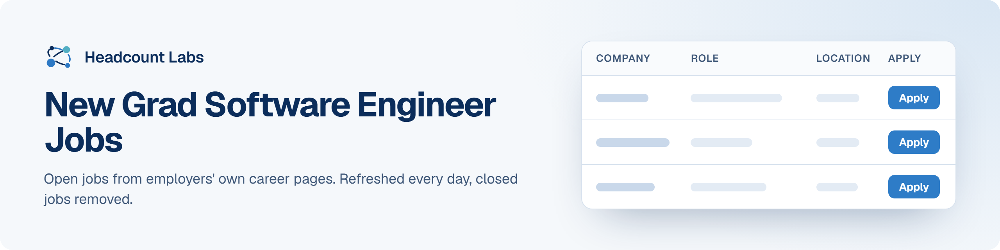

# New Grad Software Engineer Jobs

Entry-level and new graduate software engineering jobs at US employers.

**54 open jobs** · 24 new since the last update · 14 removed because they closed or left the employer's board · updated November 24, 2026 at 4:37 AM EST

This list is built and refreshed every day by [Headcount Labs](https://headcountlabs.com/?utm_source=github&utm_medium=job-list&utm_campaign=new-grad-software-engineer-jobs), which reads jobs straight from employers' own career pages and job boards. Every job here was still listed on its source board when we last read that board, within the past 3 days, and was posted in the past 30 days. Copies of the same job are merged into one row, and jobs that close are removed at the next update.

Want this data in your own app or agent? Use the [Headcount Labs jobs API](https://headcountlabs.com/docs/?utm_source=github&utm_medium=job-list&utm_campaign=new-grad-software-engineer-jobs) (free tier), the [MCP server](https://headcountlabs.com/mcp/?utm_source=github&utm_medium=job-list&utm_campaign=new-grad-software-engineer-jobs) for Claude, ChatGPT and other AI assistants, or the [public dataset subsets](https://huggingface.co/HeadcountLabs) on Hugging Face (the full dataset is coming soon).

**Full dataset.** A bigger, one-off snapshot dated 2026-10-19 (all matching jobs, not only the open jobs below) is on Hugging Face: [Tech and software jobs](https://huggingface.co/datasets/HeadcountLabs/tech-jobs). It loads with `datasets.load_dataset` and is under the Open Database License (ODbL) 1.0.

**Jump to:** [Posted in the last 7 days (14)](#posted-in-the-last-7-days) · [Posted 8 to 30 days ago (40)](#posted-8-to-30-days-ago)

**Columns.** *Apply* opens the original posting on the employer's site. *Details* opens the job on Headcount Labs, with every posting we found for it. *Remote* shows what the employer states; a dash means the posting doesn't say. *Pay* is the range the employer published.

## Posted in the last 7 days

| Company | Role | Location | Remote | Pay | Posted | Apply | Details |
| --- | --- | --- | --- | --- | --- | :---: | :---: |
| **Solerity** | JavaScript Developer Software Engineer 1(TS/SCI with Poly) | FORT MEADE, MD | — | — | Nov 23 |  | <a href="https://headcountlabs.com/catalog/jobs/f581e693-7ab9-4f2e-b6d7-0324bed18673?utm_source=github&utm_medium=job-list&utm_campaign=new-grad-software-engineer-jobs">via Headcount Labs</a> |
| **NORTHROP GRUMMAN SYSTEMS CORPORATION** | 2027 Associate Software Engineer - Pathways - Boulder CO | Boulder, CO | On-site | $76k–$114k/yr | Nov 23 |  | <a href="https://headcountlabs.com/catalog/jobs/7e406aaf-d991-4cce-884e-6a89ba9f5466?utm_source=github&utm_medium=job-list&utm_campaign=new-grad-software-engineer-jobs">via Headcount Labs</a> |
| **Viasat, Inc.** | Associate Software Engineer, Early Career | Carlsbad, CA | — | $95k–$150k/yr | Nov 19 |  | <a href="https://headcountlabs.com/catalog/jobs/ad42baf6-c8d0-4267-9d52-bd6fb7fccc49?utm_source=github&utm_medium=job-list&utm_campaign=new-grad-software-engineer-jobs">via Headcount Labs</a> |
| **RTX** | Software Engineer/Developer I (Onsite) | 

2 locations
woburn, MA tewksbury, MA
 | On-site | $63k–$120k/yr | Nov 19 |  | <a href="https://headcountlabs.com/catalog/jobs/bff146b0-de71-4034-8b52-f749631bfac7?utm_source=github&utm_medium=job-list&utm_campaign=new-grad-software-engineer-jobs">via Headcount Labs</a> |
| **RTX** | Software Engineer I (Onsite) | cedar rapids, IA | On-site | $57k–$109k/yr | Nov 19 |  | <a href="https://headcountlabs.com/catalog/jobs/2068e07a-69f3-4bb3-91e0-6292c1f30400?utm_source=github&utm_medium=job-list&utm_campaign=new-grad-software-engineer-jobs">via Headcount Labs</a> |
| **MetaPhase Consulting** | Junior Application Developer (Power Platform) for TBM | Washington, DC | — | $80k–$100k/yr | Nov 19 |  | <a href="https://headcountlabs.com/catalog/jobs/18f87512-aebc-4b76-b83b-5b407c2558f3?utm_source=github&utm_medium=job-list&utm_campaign=new-grad-software-engineer-jobs">via Headcount Labs</a> |
| **Akima** | Junior SharePoint and Power Platform Developer | Herndon, VA | Hybrid | $65k–$80k/yr | Nov 18 |  | <a href="https://headcountlabs.com/catalog/jobs/36fb740d-f290-4ef9-a9ff-0a4300212c35?utm_source=github&utm_medium=job-list&utm_campaign=new-grad-software-engineer-jobs">via Headcount Labs</a> |
| **Visionist, Inc.** | Junior Software Engineer | Columbia, MD | — | $115k–$185k/yr | Nov 17 |  | <a href="https://headcountlabs.com/catalog/jobs/55b85050-09b8-4bdb-a51c-42e42f39848e?utm_source=github&utm_medium=job-list&utm_campaign=new-grad-software-engineer-jobs">via Headcount Labs</a> |
| **Visionist, Inc.** | Junior Cloud Software Engineer | 

2 locations
Columbia, MD Laurel, MD
 | — | $115k–$165k/yr | Nov 17 |  | <a href="https://headcountlabs.com/catalog/jobs/ee04904d-e564-4fa8-bc06-f7dec453f85c?utm_source=github&utm_medium=job-list&utm_campaign=new-grad-software-engineer-jobs">via Headcount Labs</a> |
| **Relativity Space** | Software Engineer I (Factory Platform) | Long Beach, CA | — | $115k–$173k/yr | Nov 17 |  | <a href="https://headcountlabs.com/catalog/jobs/3188713d-f07a-4528-a505-94b81b2a540d?utm_source=github&utm_medium=job-list&utm_campaign=new-grad-software-engineer-jobs">via Headcount Labs</a> |
| **MetaPhase Consulting** | Junior ServiceNow Developer | United States | — | — | Nov 17 |  | <a href="https://headcountlabs.com/catalog/jobs/7ee993dc-9bea-46d1-ada7-ec28cee4d8fc?utm_source=github&utm_medium=job-list&utm_campaign=new-grad-software-engineer-jobs">via Headcount Labs</a> |
| **Intercontinental Exchange Holdings, Inc.** | Associate Software Developer | Jacksonville, FL | — | — | Nov 17 |  | <a href="https://headcountlabs.com/catalog/jobs/b2150ad1-2f8c-4b9e-8749-651dae1719ad?utm_source=github&utm_medium=job-list&utm_campaign=new-grad-software-engineer-jobs">via Headcount Labs</a> |
| **Bank of Montreal** | Software Developer (New or Recent Graduate) | 

2 locations
Berkeley Heights, NJ United States
 | — | $65k–$140k/yr | Nov 17 |  | <a href="https://headcountlabs.com/catalog/jobs/dda86cb1-028b-45c9-9c89-02daa5a07bb2?utm_source=github&utm_medium=job-list&utm_campaign=new-grad-software-engineer-jobs">via Headcount Labs</a> |
| **BAE Systems** | Software Engineer I - Applied Visualization and Interaction | Broomfield, CO | — | $65k–$110k/yr | Nov 17 |  | <a href="https://headcountlabs.com/catalog/jobs/78e37091-c592-4426-a533-5fc6ffd40308?utm_source=github&utm_medium=job-list&utm_campaign=new-grad-software-engineer-jobs">via Headcount Labs</a> |

## Posted 8 to 30 days ago

| Company | Role | Location | Remote | Pay | Posted | Apply | Details |
| --- | --- | --- | --- | --- | --- | :---: | :---: |
| **Jobgether** | Associate Software Engineer | United States | Remote | $75k–$90k/yr | Nov 16 |  | <a href="https://headcountlabs.com/catalog/jobs/15b931be-fa8f-4a36-842e-2f6a53aee4c2?utm_source=github&utm_medium=job-list&utm_campaign=new-grad-software-engineer-jobs">via Headcount Labs</a> |
| **Honeywell Aerospace** | Embedded Software Engineer I - Flight Management System | Phoenix, AZ | — | — | Nov 14 |  | <a href="https://headcountlabs.com/catalog/jobs/c901018b-b6fa-4e28-9772-728dad9370eb?utm_source=github&utm_medium=job-list&utm_campaign=new-grad-software-engineer-jobs">via Headcount Labs</a> |
| **By Light Professional IT Services LLC** | Software Engineer I | Orlando, FL | — | — | Nov 13 |  | <a href="https://headcountlabs.com/catalog/jobs/c57ba693-25e0-42ad-97d0-03df3872c071?utm_source=github&utm_medium=job-list&utm_campaign=new-grad-software-engineer-jobs">via Headcount Labs</a> |
| **SpaceX** | New Graduate Engineer, Aerospace Software (Starfall) | Hawthorne, CA | — | $125k–$160k/yr | Nov 12 |  | <a href="https://headcountlabs.com/catalog/jobs/b7e52e0f-8ef0-4cb1-a75f-3bc3ab32942d?utm_source=github&utm_medium=job-list&utm_campaign=new-grad-software-engineer-jobs">via Headcount Labs</a> |
| **PACCAR** | Robotics Software Engineer 1 | Chillicothe, OH | — | — | Nov 12 |  | <a href="https://headcountlabs.com/catalog/jobs/6647229f-15cd-49d2-8648-2cc9fee522d9?utm_source=github&utm_medium=job-list&utm_campaign=new-grad-software-engineer-jobs">via Headcount Labs</a> |
| **General Atomics** | Software Developer I | Poway, CA | On-site | — | Nov 12 |  | <a href="https://headcountlabs.com/catalog/jobs/3cfbf246-5fab-46b8-8820-ecfd76771bf9?utm_source=github&utm_medium=job-list&utm_campaign=new-grad-software-engineer-jobs">via Headcount Labs</a> |
| **CGI Technologies and Solutions, Inc.** | Software Developer – Entry Level (January Start) | Knoxville, TN | — | $58k–$96k/yr | Nov 12 |  | <a href="https://headcountlabs.com/catalog/jobs/66a6f38b-354e-4d1b-8ddd-f125eac3db09?utm_source=github&utm_medium=job-list&utm_campaign=new-grad-software-engineer-jobs">via Headcount Labs</a> |
| **Affirm** | Software Engineer I, Backend (Continuous Delivery) | United States | Remote | — | Nov 12 |  | <a href="https://headcountlabs.com/catalog/jobs/3da0b698-bbab-4e5e-bd5b-7487ff6805c6?utm_source=github&utm_medium=job-list&utm_campaign=new-grad-software-engineer-jobs">via Headcount Labs</a> |
| **Rectangle Health** | Junior Power BI Developer | White Plains, NY | On-site | $75k–$100k/yr | Nov 11 |  | <a href="https://headcountlabs.com/catalog/jobs/305e802b-1966-4d9c-bc13-fe1c3ecd6fd6?utm_source=github&utm_medium=job-list&utm_campaign=new-grad-software-engineer-jobs">via Headcount Labs</a> |
| **General Atomics and Affiliated Companies** | Software Developer I | Poway, CA | — | — | Nov 11 |  | <a href="https://headcountlabs.com/catalog/jobs/da7403ac-63d7-4ad8-a771-56a24f59d4ab?utm_source=github&utm_medium=job-list&utm_campaign=new-grad-software-engineer-jobs">via Headcount Labs</a> |
| **ECS Ltd** | Junior Software Developer | Chantilly, VA | — | $85k–$114k/yr | Nov 11 |  | <a href="https://headcountlabs.com/catalog/jobs/dc7f3777-d160-4749-adba-4d680aa8fcc7?utm_source=github&utm_medium=job-list&utm_campaign=new-grad-software-engineer-jobs">via Headcount Labs</a> |
| **Boeing** | Associate Software Engineer | 

2 locations
Albuquerque, NM El Segundo, CA
 | On-site | $99k–$144k/yr | Nov 11 |  | <a href="https://headcountlabs.com/catalog/jobs/aefd59df-9652-4705-a0ac-1798e9386e16?utm_source=github&utm_medium=job-list&utm_campaign=new-grad-software-engineer-jobs">via Headcount Labs</a> |
| **SAIC** | Java Backend Developer Junior | Ashburn, VA | Hybrid | $60k–$100k/yr | Nov 10 |  | <a href="https://headcountlabs.com/catalog/jobs/792221a9-c2a3-490d-9fc5-015f081217a3?utm_source=github&utm_medium=job-list&utm_campaign=new-grad-software-engineer-jobs">via Headcount Labs</a> |
| **iSoftStone** | Junior Full Stack Software Engineer | Palo Alto, CA | — | $38–$42/hr | Nov 10 |  | <a href="https://headcountlabs.com/catalog/jobs/a4c44b27-4e6c-4da0-8d00-8b5721d7ef5f?utm_source=github&utm_medium=job-list&utm_campaign=new-grad-software-engineer-jobs">via Headcount Labs</a> |
| **Govcio LLC** | IAM Junior Software Engineer (Remote) | United States | Remote | $75k–$100k/yr | Nov 10 |  | <a href="https://headcountlabs.com/catalog/jobs/9fa444c6-d81d-40ef-9e21-124e98c5ec7b?utm_source=github&utm_medium=job-list&utm_campaign=new-grad-software-engineer-jobs">via Headcount Labs</a> |
| **Find a Career - Textron** | Software Engineer I | Wilmington, MA | — | $83k–$125k/yr | Nov 10 |  | <a href="https://headcountlabs.com/catalog/jobs/bdc618fa-a15a-4374-829a-db9b10b0a2d3?utm_source=github&utm_medium=job-list&utm_campaign=new-grad-software-engineer-jobs">via Headcount Labs</a> |
| **Applied Medical** | Software Test Engineer I | Rancho Santa Margarita, CA | — | $72k–$85k/yr | Nov 10 |  | <a href="https://headcountlabs.com/catalog/jobs/d3ee3304-1091-416f-8fb0-a0430997bf71?utm_source=github&utm_medium=job-list&utm_campaign=new-grad-software-engineer-jobs">via Headcount Labs</a> |
| **L3HHCM20** | Specialist, Software Engineer 1 | Greenville, TX | On-site | — | Nov 9 |  | <a href="https://headcountlabs.com/catalog/jobs/5feca993-e7f3-402e-ac2a-55b5a47674d4?utm_source=github&utm_medium=job-list&utm_campaign=new-grad-software-engineer-jobs">via Headcount Labs</a> |
| **HII** | SharePoint Developer 1 | Annapolis Junction, MD | — | $78k–$88k/yr | Nov 8 |  | <a href="https://headcountlabs.com/catalog/jobs/e0faafc6-affe-4b24-b027-6bc6cf64d484?utm_source=github&utm_medium=job-list&utm_campaign=new-grad-software-engineer-jobs">via Headcount Labs</a> |
| **CGI Technologies and Solutions, Inc.** | Software Developer – Entry Level | Lafayette, LA | — | $52k–$96k/yr | Nov 7 |  | <a href="https://headcountlabs.com/catalog/jobs/d390edb7-6fd4-4009-a31d-b69203f6fa73?utm_source=github&utm_medium=job-list&utm_campaign=new-grad-software-engineer-jobs">via Headcount Labs</a> |
| **Intercontinental Exchange Holdings, Inc.** | Junior Software Development Engineer in Test | Atlanta, GA | — | — | Nov 6 |  | <a href="https://headcountlabs.com/catalog/jobs/042d7099-8622-4cc6-9a1d-b55faac16d76?utm_source=github&utm_medium=job-list&utm_campaign=new-grad-software-engineer-jobs">via Headcount Labs</a> |
| **CGI Technologies and Solutions, Inc.** | Software Developer – Entry Level (Top Secret Clearance Required) | Fairfax, VA | — | $58k–$105k/yr | Nov 6 |  | <a href="https://headcountlabs.com/catalog/jobs/99612bc7-fc8d-4c19-acf0-e13bb51f0b0a?utm_source=github&utm_medium=job-list&utm_campaign=new-grad-software-engineer-jobs">via Headcount Labs</a> |
| **ASRC Federal Holding Company** | Associate Software Engineer | 

2 locations
Moorestown, NJ Huntsville, AL
 | — | — | Nov 6 |  | <a href="https://headcountlabs.com/catalog/jobs/5b2a874e-8d17-4c8a-b364-7b9ca592be08?utm_source=github&utm_medium=job-list&utm_campaign=new-grad-software-engineer-jobs">via Headcount Labs</a> |
| **Capgemini** | Tech Support analyst - Associate Software Technician | 

2 locations
Atlanta, GA Tampa, FL
 | Hybrid | $30k–$60k/yr | Nov 5 |  | <a href="https://headcountlabs.com/catalog/jobs/e4d98699-a1e2-40ab-8003-4707eb5b80aa?utm_source=github&utm_medium=job-list&utm_campaign=new-grad-software-engineer-jobs">via Headcount Labs</a> |
| **ASRC Federal** | Associate Software Engineer | Moorestown, NJ | On-site | — | Nov 5 |  | <a href="https://headcountlabs.com/catalog/jobs/10b2df7e-732b-49b6-be64-0af9e3a38523?utm_source=github&utm_medium=job-list&utm_campaign=new-grad-software-engineer-jobs">via Headcount Labs</a> |
| **Stellantis** | Onboard Junior Software Enginner | Auburn Hills, MI | — | — | Nov 4 |  | <a href="https://headcountlabs.com/catalog/jobs/6cb2a39e-f538-4cd0-9f9f-ee3601a33793?utm_source=github&utm_medium=job-list&utm_campaign=new-grad-software-engineer-jobs">via Headcount Labs</a> |
| **RELX INC** | Tech Accelerate Graduate Program - Software Engineer I | Alpharetta, GA | — | $59k–$99k/yr | Nov 4 |  | <a href="https://headcountlabs.com/catalog/jobs/8f012d1f-3912-4955-8ba2-02512fa5e16a?utm_source=github&utm_medium=job-list&utm_campaign=new-grad-software-engineer-jobs">via Headcount Labs</a> |
| **RealmOne** | RF Software Engineer 1 | Central Maryland, MD | — | — | Nov 4 |  | <a href="https://headcountlabs.com/catalog/jobs/b9bd01ea-7732-4625-97a3-759d8182a58c?utm_source=github&utm_medium=job-list&utm_campaign=new-grad-software-engineer-jobs">via Headcount Labs</a> |
| **Credigy** | Junior.Net Developer | Norcross, GA | — | — | Nov 4 |  | <a href="https://headcountlabs.com/catalog/jobs/e7a768a1-40f9-4d42-9082-1d2ba063f524?utm_source=github&utm_medium=job-list&utm_campaign=new-grad-software-engineer-jobs">via Headcount Labs</a> |
| **Akima** | Web Developer, Junior (Active Secret Clearance or Able to Obtain) | Orlando, FL | On-site | — | Nov 4 |  | <a href="https://headcountlabs.com/catalog/jobs/8f50b802-ff9d-4eea-bc41-29f3da96b000?utm_source=github&utm_medium=job-list&utm_campaign=new-grad-software-engineer-jobs">via Headcount Labs</a> |
| **SAIC** | Java Developer / Automation Test Engineer Junior | Ashburn, VA | — | $60k–$100k/yr | Nov 3 |  | <a href="https://headcountlabs.com/catalog/jobs/f43ee7c8-9118-4555-8578-90564efae0f9?utm_source=github&utm_medium=job-list&utm_campaign=new-grad-software-engineer-jobs">via Headcount Labs</a> |
| **Penske** | Software Engineer I | 

2 locations
Reading, PA Tampa, FL
 | On-site | — | Nov 3 |  | <a href="https://headcountlabs.com/catalog/jobs/d48f34b1-2d8c-45a2-8801-351b664d68fc?utm_source=github&utm_medium=job-list&utm_campaign=new-grad-software-engineer-jobs">via Headcount Labs</a> |
| **Automated Health Systems** | Junior Software Developer | Pittsburgh, PA | — | — | Nov 3 |  | <a href="https://headcountlabs.com/catalog/jobs/fbdaa908-c40a-42e2-bd34-4b924ea738ae?utm_source=github&utm_medium=job-list&utm_campaign=new-grad-software-engineer-jobs">via Headcount Labs</a> |
| **Verkada** | Backend Software Engineer - University Graduate 2027 | San Mateo | On-site | $120k–$140k/yr | Nov 2 |  | <a href="https://headcountlabs.com/catalog/jobs/054964ff-b8a5-4acb-bb73-0cb09a4b0e82?utm_source=github&utm_medium=job-list&utm_campaign=new-grad-software-engineer-jobs">via Headcount Labs</a> |
| **Smartsheet** | Software Engineer I (Remote Eligible) | United States | Remote | $108k–$148k/yr | Nov 2 |  | <a href="https://headcountlabs.com/catalog/jobs/69cd95cc-82b3-460a-9239-348868756f2c?utm_source=github&utm_medium=job-list&utm_campaign=new-grad-software-engineer-jobs">via Headcount Labs</a> |
| **TransDigm Group Inc.** | Software Engineer I | Vergennes, VT | — | — | Oct 30 |  | <a href="https://headcountlabs.com/catalog/jobs/cba2c5a0-7410-4de0-9901-924221549809?utm_source=github&utm_medium=job-list&utm_campaign=new-grad-software-engineer-jobs">via Headcount Labs</a> |
| **ASRC Federal Holding Company** | Junior Software Developer | Suffolk, VA | — | — | Oct 30 |  | <a href="https://headcountlabs.com/catalog/jobs/3a52661d-0557-4882-bc85-cb79bba5316a?utm_source=github&utm_medium=job-list&utm_campaign=new-grad-software-engineer-jobs">via Headcount Labs</a> |
| **Vituity** | Software Engineer I - Remote - Nationwide | Sacramento, CA | Remote | $70k–$87k/yr | Oct 28 |  | <a href="https://headcountlabs.com/catalog/jobs/1c604055-fb29-4e9b-ab83-3e8f735689c7?utm_source=github&utm_medium=job-list&utm_campaign=new-grad-software-engineer-jobs">via Headcount Labs</a> |
| **Veolia** | Junior Manufacturing Software Engineer | Boulder, CO | — | $78k–$90k/yr | Oct 28 |  | <a href="https://headcountlabs.com/catalog/jobs/55231ba9-21ee-4ade-a306-9da3bc21c2bb?utm_source=github&utm_medium=job-list&utm_campaign=new-grad-software-engineer-jobs">via Headcount Labs</a> |
| **General Dynamics Mission Systems, Inc** | Software Engineer – Entry Level | Manassas, VA | Remote | $76k/yr | Oct 26 |  | <a href="https://headcountlabs.com/catalog/jobs/dfdeb8b1-d68d-4661-93af-f2849f7cd08c?utm_source=github&utm_medium=job-list&utm_campaign=new-grad-software-engineer-jobs">via Headcount Labs</a> |

## Related data on Headcount Labs

- [Software engineer salary data from posted pay](https://headcountlabs.com/salary-data/software-engineer/)
- [Software engineer job postings dataset](https://headcountlabs.com/data/software-engineer-job-postings/)
- [US job market report: open jobs by state, top employers, pay and remote share](https://headcountlabs.com/reports/us-job-market/)

## More lists from Headcount Labs

[Software Engineering Internships](https://github.com/HeadcountLabs/software-engineering-internships) · [Data Science, AI and Machine Learning Internships](https://github.com/HeadcountLabs/data-science-ai-internships) · [Engineering Internships](https://github.com/HeadcountLabs/engineering-internships) · [Business, Finance and Marketing Internships](https://github.com/HeadcountLabs/business-finance-internships) · [Internships in the US](https://github.com/HeadcountLabs/internships) · [Entry-Level and New Grad Jobs](https://github.com/HeadcountLabs/entry-level-jobs) · [Entry-Level Data Analyst Jobs](https://github.com/HeadcountLabs/entry-level-data-analyst-jobs) · [Remote Software Engineer Jobs](https://github.com/HeadcountLabs/remote-software-engineer-jobs) · [Remote Data, AI and Machine Learning Jobs](https://github.com/HeadcountLabs/remote-data-jobs) · [Remote Product Manager Jobs](https://github.com/HeadcountLabs/remote-product-manager-jobs) · [Remote Marketing Jobs](https://github.com/HeadcountLabs/remote-marketing-jobs) · [Remote Sales Jobs](https://github.com/HeadcountLabs/remote-sales-jobs) · [Remote Customer Support and Success Jobs](https://github.com/HeadcountLabs/remote-customer-support-jobs) · [Remote Healthcare Jobs](https://github.com/HeadcountLabs/remote-healthcare-jobs) · [Remote Finance and Accounting Jobs](https://github.com/HeadcountLabs/remote-finance-accounting-jobs) · [Remote Jobs in the US](https://github.com/HeadcountLabs/remote-jobs) · [AI and Machine Learning Engineer Jobs](https://github.com/HeadcountLabs/ai-ml-engineer-jobs) · [Data Engineer Jobs](https://github.com/HeadcountLabs/data-engineer-jobs) · [Cybersecurity Jobs](https://github.com/HeadcountLabs/cybersecurity-jobs) · [Product Manager Jobs](https://github.com/HeadcountLabs/product-manager-jobs) · [Registered Nurse Jobs](https://github.com/HeadcountLabs/registered-nurse-jobs) · [Software Jobs Paying $200k+](https://github.com/HeadcountLabs/high-paying-software-jobs) · [Tech and Software Jobs in the US](https://github.com/HeadcountLabs/tech-jobs) · [Jobs with Salary Listed in the US](https://github.com/HeadcountLabs/pay-transparency-jobs) · [San Francisco Bay Area Tech Jobs](https://github.com/HeadcountLabs/bay-area-tech-jobs) · [New York City Tech Jobs](https://github.com/HeadcountLabs/new-york-tech-jobs) · [Seattle Tech Jobs](https://github.com/HeadcountLabs/seattle-tech-jobs) · [Austin Tech Jobs](https://github.com/HeadcountLabs/austin-tech-jobs) · [Boston Tech Jobs](https://github.com/HeadcountLabs/boston-tech-jobs) · [Los Angeles Tech Jobs](https://github.com/HeadcountLabs/los-angeles-tech-jobs) · [Washington, DC Tech Jobs](https://github.com/HeadcountLabs/washington-dc-tech-jobs)

## Contributing

This README is generated, so edits to it are overwritten at the next update. If a job is closed, a link is broken or a detail is wrong, [open an issue](../../issues/new) with the link and we'll fix it in the data, which fixes it everywhere. Requests for new lists are welcome too.

## License

The list data is under the [Open Database License (ODbL) 1.0](LICENSE). Our own values in it are under the [Database Contents License (DbCL) 1.0](https://opendatacommons.org/licenses/dbcl/1-0/). Credit "Headcount Labs (https://headcountlabs.com)" when you reuse it. Job description text is the employer's own text and is not licensed by us. Takedown requests: [https://headcountlabs.com/remove/](https://headcountlabs.com/remove/). Location data includes data from OpenStreetMap contributors (ODbL) and Overture Maps. The same rows are in [`data/jobs.csv`](data/jobs.csv).

Generated by Headcount Labs from the jobs API on November 24, 2026 at 4:37 AM EST. At most 8 jobs per employer are shown in each list.
